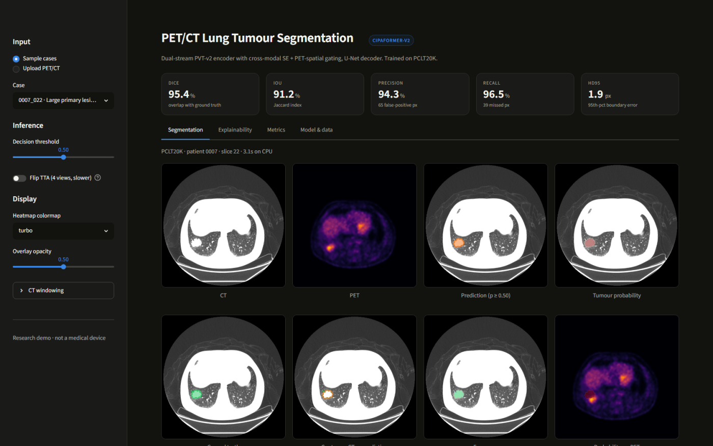

# PET/CT Lung Tumour Segmentation

An interactive Streamlit app for **CIPAFormer-V2**, a dual-stream PET/CT segmentation network
trained on PCLT20K. Pick a bundled slice or upload your own PET/CT pair, and the app runs the
real checkpoint and shows the mask, the metrics, and *why* the network fired where it did.



## What it does

**Segmentation** — CT, PET, predicted mask, probability heatmap, ground truth, contour
comparison and a colour-coded error map (true positive / false positive / missed). The mask,
probability map and a composite report figure are all downloadable as PNG.

**Explainability** — four gradient attribution methods (Grad-CAM, HiRes-CAM, Layer-CAM,
XGrad-CAM) adapted to dense prediction: the score back-propagated is the logit energy inside
the predicted tumour, not a class score. Any of six target layers can be probed, from the
sharpest decoder block to the most semantic fusion stage. Also on this tab:

- the network's own **PET→CT spatial gate** at each fusion scale — a built-in interpretability
  signal showing where PET is pushing the CT stream;
- **uncertainty** — predictive entropy, the ambiguous 0.3–0.7 probability band, and a
  test-time-augmentation disagreement map when flip TTA is on;
- **modality importance** — each modality blanked in turn, so you can see what CT alone and
  PET alone recover.

**Metrics** — Dice, IoU, precision, recall, specificity, accuracy, HD95, ASSD, confusion
counts, and a threshold sweep that marks the Dice-optimal operating point.

## Run locally

```bash
pip install -r requirements.txt
python tools/export_weights.py checkpoints/best.pth weights/cipaformer_v2_ema_fp16.pth
streamlit run app.py
```

If you already have `checkpoints/best.pth` in place, the app loads it directly and the export
step is optional — it just makes a 118 MB fp16 copy instead of the 450 MB training checkpoint.

## Deploy on Streamlit Community Cloud

The weights are too large for a git repository, so they are downloaded once at first run.

1. **Push this folder to GitHub.** `weights/`, `checkpoints/` and the full `PCLT20K/` dataset
   are gitignored; the four slices in `samples/` are committed.
2. **Attach the weights to a GitHub release.** In your repo, *Releases → Draft a new release →
   Attach binaries*, and upload `weights/cipaformer_v2_ema_fp16.pth` (release assets allow up to
   2 GB — normal repo files are capped at 100 MB). Copy the asset's download URL.
3. **Deploy.** Go to [share.streamlit.io](https://share.streamlit.io), connect the repo, and set
   the main file to `app.py`.
4. **Add the URL as a secret.** In the app's *Settings → Secrets*, paste:

   ```toml
   MODEL_URL = "https://github.com/<user>/<repo>/releases/download/v1.0/cipaformer_v2_ema_fp16.pth"
   ```

The app downloads the weights on first boot (with a progress bar) and caches them for the
life of the container. `MODEL_URL` is also read from the environment, so the same code runs
anywhere.

### Hugging Face Spaces

Spaces works too and is a better fit for the memory profile: create a Space with the Streamlit
SDK, push the same files, and commit the weights directly (Spaces handles large files through
LFS, so no release asset or `MODEL_URL` is needed).

### Why not Vercel

Vercel runs serverless functions with a 250 MB unzipped bundle limit and short execution
windows. PyTorch plus a 118 MB checkpoint plus a ~3 s CPU forward pass does not fit that
model — a Vercel deployment would need the inference moved to a separate always-on host, at
which point Streamlit Cloud or Spaces is doing the same job with none of the plumbing.

## Project layout

```
app.py                  Streamlit UI
core/model.py           CIPAFormer-V2 architecture + checkpoint resolution
core/inference.py       preprocessing, prediction, TTA, metrics
core/explain.py         Grad-CAM family, PET gate maps, entropy
core/viz.py             overlays and composite figures
samples/                four PCLT20K slices (CT / PET / mask)
tools/export_weights.py training checkpoint -> slim fp16 inference weights
```

## Model

| | |
|---|---|
| Encoder | PVT-v2-b3, weight-shared across PET and CT, 4 stages (stride 4→32) |
| Fusion | per-stage SE channel gate + 7×7 PET-derived spatial gate applied to CT as `ct × (1 + gate)` |
| Decoder | U-Net, three upsampling blocks with skips, 1×1 head |
| Input | 512×512 grayscale PET and CT, normalised to [-1.6, 1.6] |
| Output | one sigmoid channel |
| Weights | EMA of training weights, fp16 for deployment |

Reported test performance (5 seeds, held-out split): IoU 64.2, Dice 78.2, precision 75.0,
recall 81.8, specificity 99.9. Individual slices vary widely around that mean — the bundled
samples run between roughly 66 and 96 Dice.

## Data

`samples/` contains four slices from **PCLT20K** with their expert masks. To use your own
data, supply a CT slice and a PET slice of the same anatomy as PNG or JPEG; a mask is optional
and only needed for the metrics.

---

**Research demo — not a medical device.** Nothing here is validated for clinical use, and no
output should inform diagnosis or treatment.
